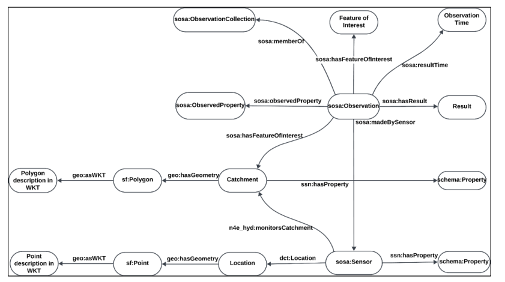

# NFDI4Earth HYOBS Ontology

The **NFDI4Earth HYOBS Ontology** is a lightweight, domain-specific ontology for describing **hydrometeorological concepts, variables, and relationships** in a semantically consistent and machine-readable way.  

It is designed to support the **FAIR** (Findable, Accessible, Interoperable, Reusable) principles for hydrological data by enabling semantic annotation, RDF transformation, and integration into knowledge graphs.

This ontology is maintained in **LinkML** for modularity, validation, and easy export to OWL, JSON-LD, and other formats.

---

## 📍 Base URI and Prefix

- **Base URI:** [https://w3id.org/hmontology/](https://w3id.org/hmontology/)  
- **Recommended prefix:** `hyobs`

---

## 🌊 Purpose and Scope

Hydrological datasets are often shared in formats like CSV, which lack semantic annotations, making data discovery, reuse, and automated reasoning difficult.  

The HYOBS Ontology addresses this by:

- Linking to widely used vocabularies (SOSA, QUDT, EnvThes, Schema.org, etc.).
- Supporting the semantic transformation of datasets such as **LamaH-CE**, **CAMELS-GB** and **QUADICA**
- Enabling integration into **knowledge graphs** for advanced querying and reasoning.

---

## 🚀 Key Features

- **OWL-compliant** and based on RDF(S) and OWL standards.
- Built and maintained using **[LinkML](https://linkml.io/)**.
- Alignments with:
  - [SOSA/SSN](https://www.w3.org/TR/vocab-ssn/) – sensors and observations.
  - [QUDT](http://qudt.org/) – units and quantities.
  - [EnvThes](https://vocabs.lter-europe.net/EnvThes/en/) – environmental terminology.
  - [Schema.org](https://schema.org/) – general-purpose concepts.
- Support for mapping **CSV columns → ontology concepts** via [HydroTurtle](https://github.com/shamilasudalshana/NFDI4Earth-HydroTurtle).

---

## 🧪 Example Use Cases

The ontology was used to annotate and convert three datasets (LamaH-CE, CAMELS-GB, QUADICA) to RDF. This enabled:

- Integration of **catchment attributes** and **time series** in a knowledge graph.
- Complex **SPARQL queries** for hydrological analysis.
- **Natural Language Question Answering (NLQA)** over hydrological RDF data.

The datasets as well as questions assessed during the NLQA can be seen [here](https://github.com/aurioldegbelo/hints4text-to-sparql/).

---

## 🔗 Re-using the Ontology

- **OWL (Turtle):** [`LinkML_hydro_test.owl`](./LinkML_hydro_test.owl)  
- **Online version:** View [here](https://w3id.org/hmontology/)  
- **Mapping files:** See [HydroTurtle](https://github.com/shamilasudalshana/NFDI4Earth-HydroTurtle2)
- **Basic data model diagram:** 

---

## 👥 Contact

- **[Shamila Herath](mailto:lunde@adobe.com)**
- **[Auriol Degbelo](https://sites.google.com/site/aurioldegbelo/)**

---

## 🙏 Acknowledgments

This ontology is developed as part of the **[NFDI4Earth](https://www.nfdi4earth.de/)** initiative, aiming to advance research data management in Earth System Sciences. The work is funded by the German Research Foundation (DFG) under project number 460036893.

## 📜 Citation

If you use the HYOBS Ontology in your work, please cite: <code style="color : red"> tba</code>

